# 화면 흐름과 XCUITest

실제 SwiftUI 화면을 XCUITest가 눌러 이동하며 캡처한다. 아래 화면은 DEBUG 테스트 fixture로 생성한 것이며 Apple 로그인·HealthKit·서버 API의 실제 연동 성공을 의미하지 않는다. 기존 SwiftData 스키마와 사용자 파일은 변경하지 않는다.

## 화면 흐름

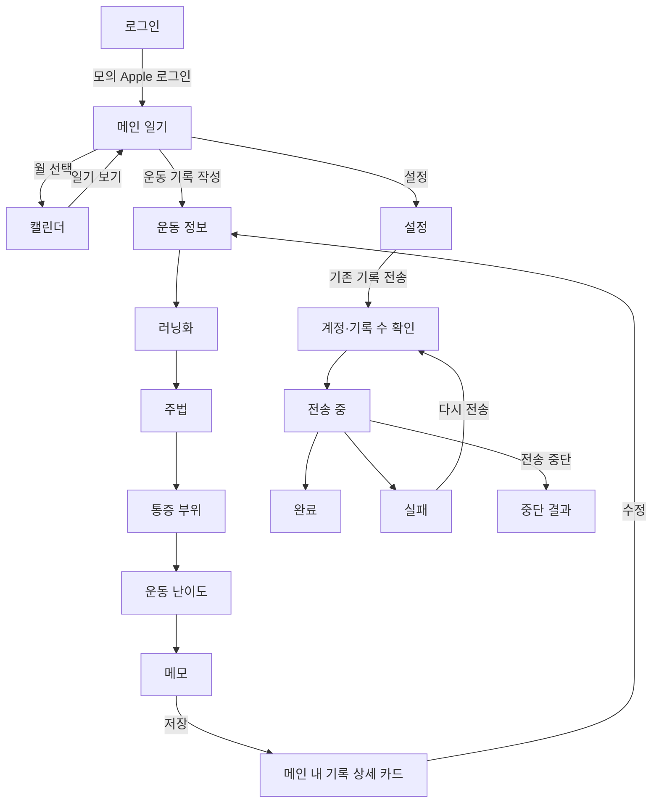

기록 상세는 별도 화면이 아니라 메인에 표시되는 카드다. 수정 버튼이 없던 카드에 기존 수정 동작으로 연결하는 버튼을 추가했다. 작성과 수정은 같은 6단계 화면을 사용한다.

## 재실행

```sh
xcrun simctl list devices available
SIMULATOR_ID=<UDID> bash Scripts/run-ui-flow.sh
python3 Scripts/export-ui-flow.py /tmp/RunningDiary-UIFlow-....xcresult /tmp/ui-captures-new
```

`UI_FLOW_RESULT`로 새 결과 경로를 지정할 수 있다. Xcode에서 RunDiary 스킴의 RunDiaryUITests를 실행해도 된다. 기존 Swift 매크로 의존성을 Xcode에서 승인하거나 신뢰한 로컬 CLI 환경에서 `bash Scripts/run-ui-flow.sh -skipMacroValidation`으로 실행한다.

CI의 RunDiary 스킴에 UI 테스트를 포함하며, UI 테스트 파일 변경도 CI를 실행한다. 테스트 결과는 기존 `test-results` artifact에 보관된다. 시뮬레이터가 공유되지 않도록 UI 타깃은 병렬 실행을 끈다. 화면 전환 애니메이션 후 `hittable`을 기다리고, 고정 지연 대신 화면 상태를 확인한다.

## 시나리오

| 테스트 | 검증 |
|---|---|
| MainCalendarSettingsMigrationFlow | 빈 메인 → 캘린더 → 설정 → 이관 확인 → 완료 |
| MockLoginFlow | 로그인 화면 → 모의 인증 → 메인 |
| CreateDetailEditFlow | 샘플 운동 → 작성 6단계 → 저장 → 상세 → 수정 → 변경된 메모 확인 |
| MigrationFailureRetryFlow | 전송 실패 문구 → 재시도 → 완료 |
| MigrationProgressCancelFlow | 진행률 표시 → 중단 → 재시작 버튼 활성화 |

## 범위와 제한

- 테스트 시작 인자 `--ui-testing`은 DEBUG에서만 해석한다. 메모리 SwiftData·인메모리 인증 상태·HealthKit/인증/날씨/러닝화/이관 응답 fixture를 사용한다.
- 실제 저장·수정 UI는 메모리 저장소를 사용한다. 영구 저장소와 키체인 초기화, 서버 업로드는 수행하지 않는다.
- 실제 과거 사용자 스토어, 실기기 HealthKit 권한, Apple 인증, 서버 데이터 대조, 영구 체크포인트의 재시도는 별도 통합 검증이다.
- 모든 조합의 입력 오류·다국어·다크모드·글자 크기는 이번 캡처 범위에 포함하지 않는다.
- 캡처는 아래 갤러리에서 원본 크기로 열 수 있다. 날짜는 실행 날짜를 사용한다.

## 화면 캡처

| 화면 | 화면 |
|---|---|
| 빈 기록 메인<br><a href="ui-screen-flow/01-main.png">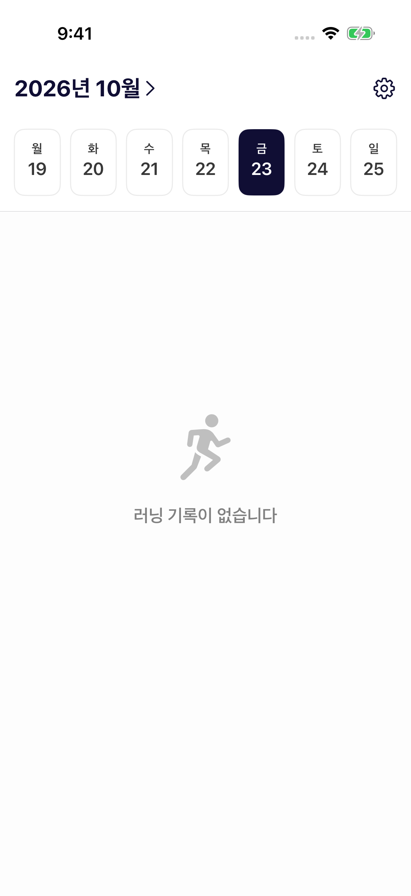</a> | 캘린더<br><a href="ui-screen-flow/02-calendar.png">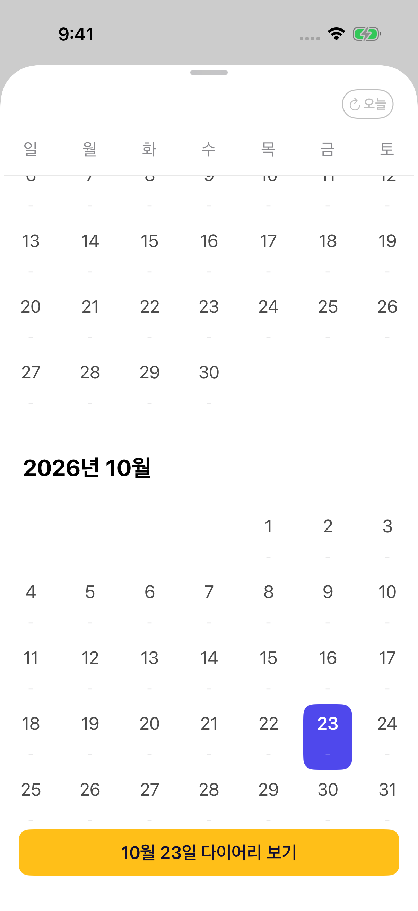</a> |
| 설정<br><a href="ui-screen-flow/03-settings.png">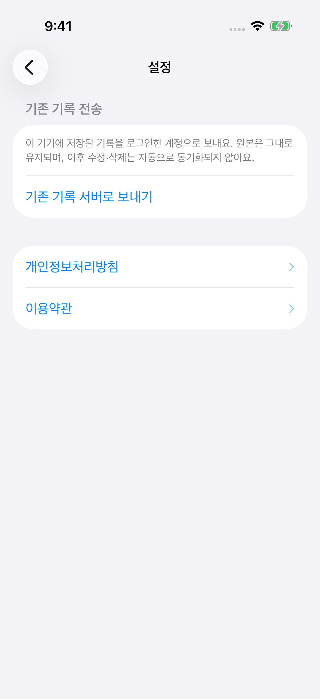</a> | 이관 확인<br><a href="ui-screen-flow/04-migration-confirm.png"></a> |
| 이관 완료<br><a href="ui-screen-flow/05-migration-complete.png">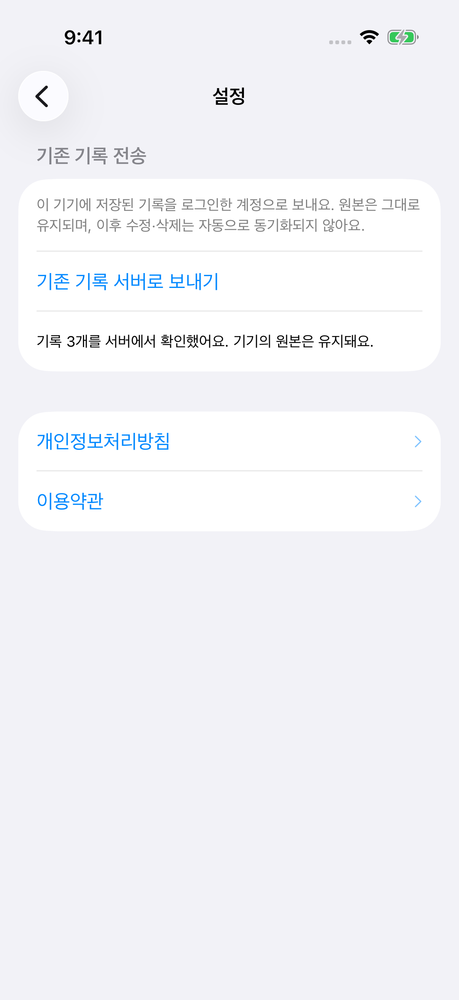</a> | 로그인<br><a href="ui-screen-flow/06-login-mock.png">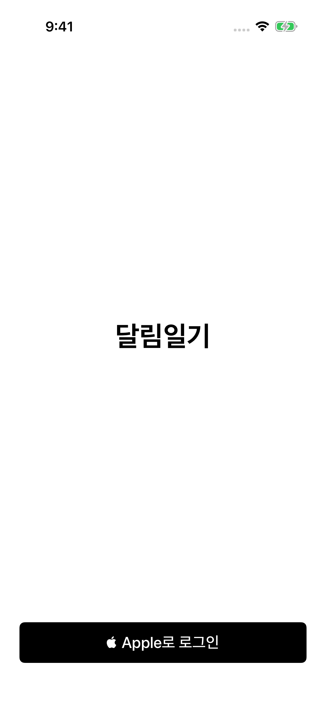</a> |
| 모의 로그인 후 메인<br><a href="ui-screen-flow/07-login-main.png"></a> | 이관 실패<br><a href="ui-screen-flow/08-migration-failed.png">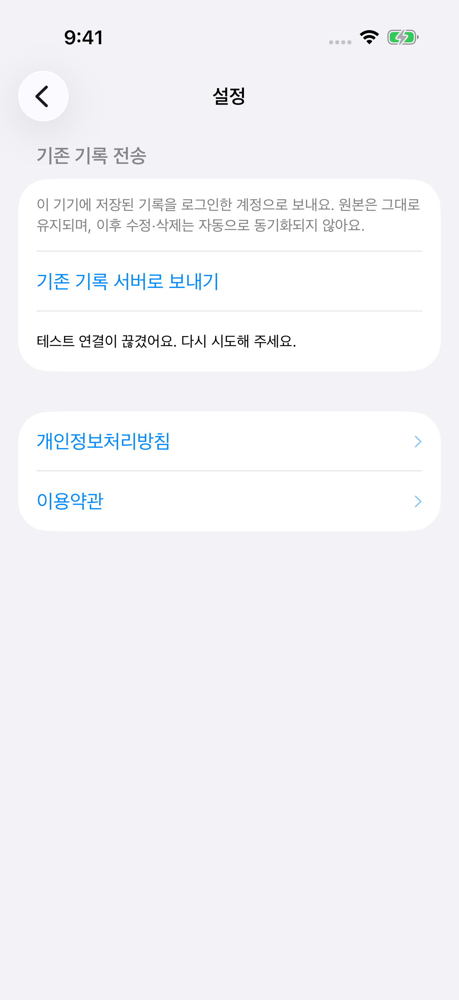</a> |
| 재시도 확인<br><a href="ui-screen-flow/09-migration-retry-confirm.png">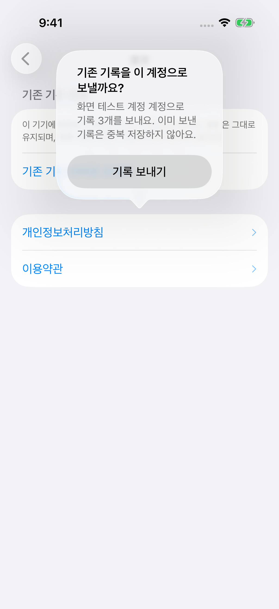</a> | 재시도 완료<br><a href="ui-screen-flow/10-migration-retry-complete.png"></a> |
| 전송 진행 중<br><a href="ui-screen-flow/11-migration-progress.png">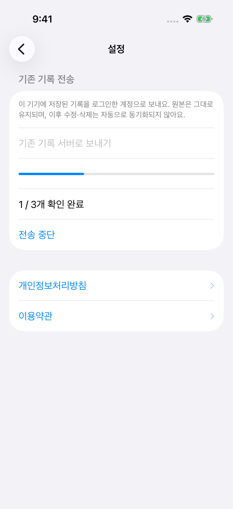</a> | 전송 중단<br><a href="ui-screen-flow/12-migration-cancelled.png">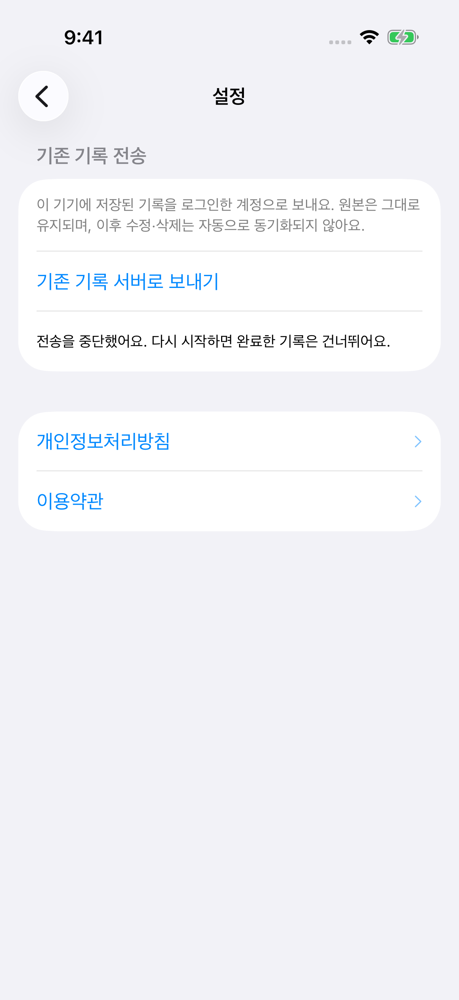</a> |
| 샘플 운동 카드<br><a href="ui-screen-flow/13-workout.png">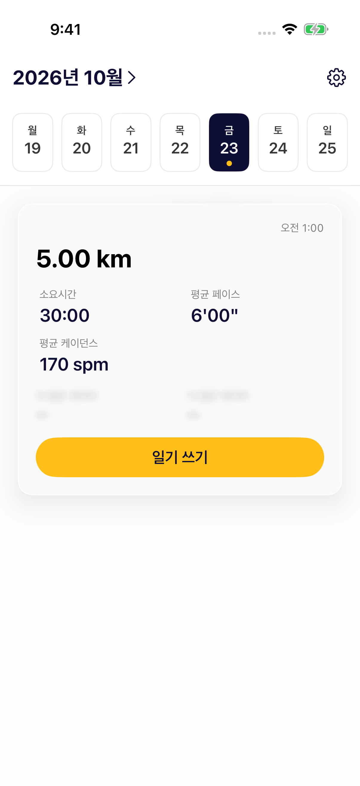</a> | 작성: 운동 정보<br><a href="ui-screen-flow/14-create-fitness.png">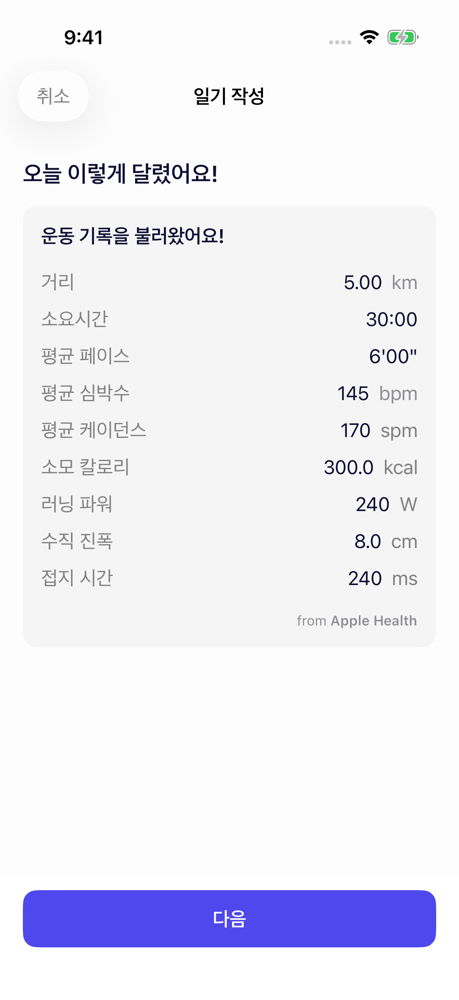</a> |
| 작성: 러닝화<br><a href="ui-screen-flow/15-create-shoes.png">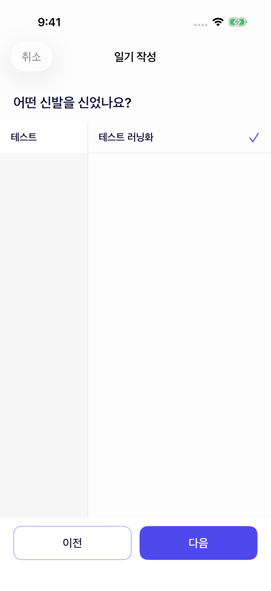</a> | 작성: 주법<br><a href="ui-screen-flow/16-create-style.png">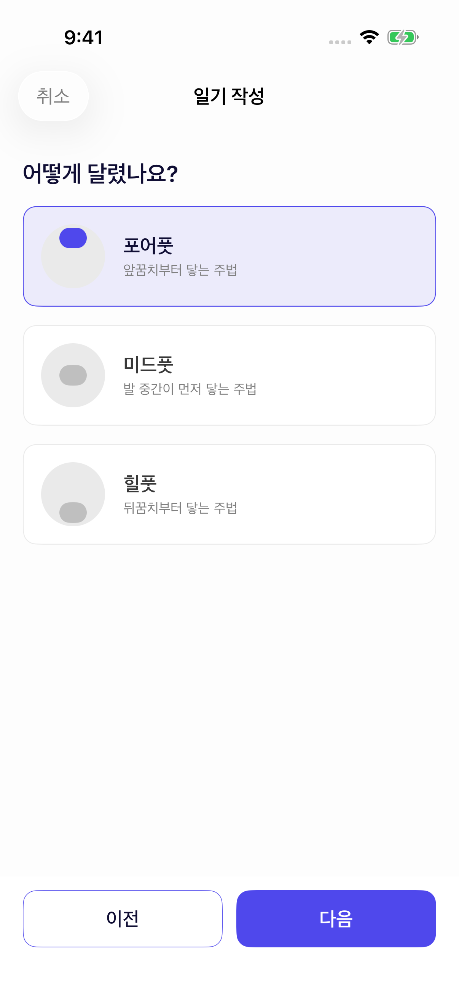</a> |
| 작성: 통증 부위<br><a href="ui-screen-flow/17-create-pain.png">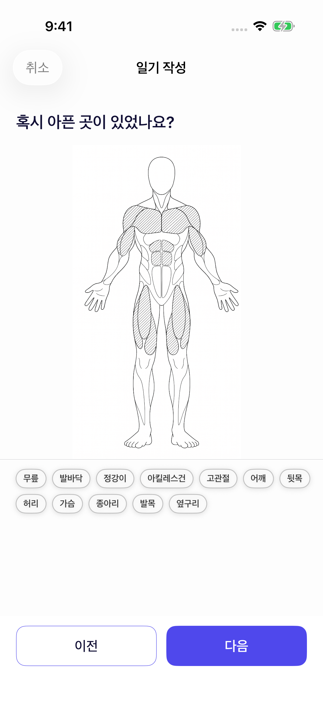</a> | 작성: 난이도<br><a href="ui-screen-flow/18-create-difficulty.png">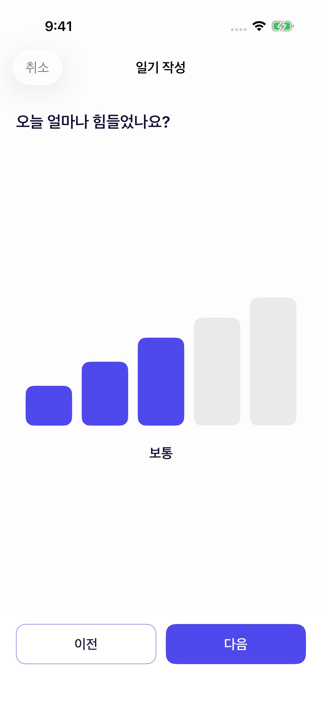</a> |
| 작성: 메모<br><a href="ui-screen-flow/19-create-memo.png">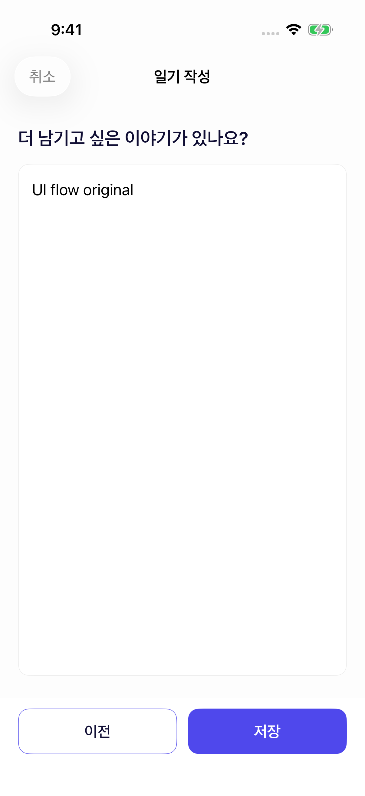</a> | 저장된 기록 상세<br><a href="ui-screen-flow/20-record-detail.png">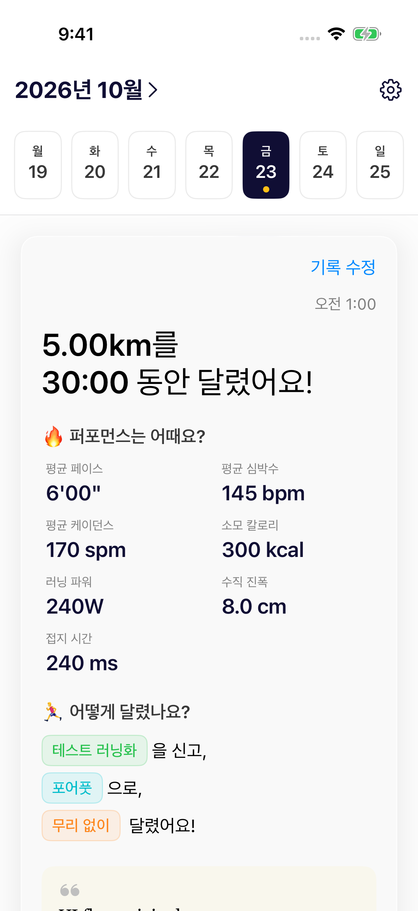</a> |
| 수정: 메모<br><a href="ui-screen-flow/21-edit-memo.png"></a> | 수정 저장 결과<br><a href="ui-screen-flow/22-record-updated.png">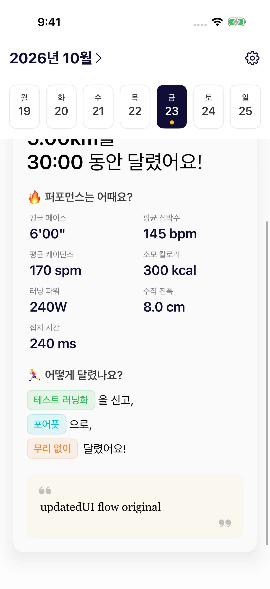</a> |

## 검증 결과 — 2026-10-23

- iPhone 17 Pro / iOS 26.5: 5개 UI 테스트, 0개 실패, 123.054초.
- 앱·UI 테스트 번들 빌드 성공. 최종 실행에서 이름 있는 캡처 22개를 추출했다.
- git diff --check, 프로젝트 plist 및 스크립트 구문 확인 완료.
- 전체 단위 테스트는 이번 로컬 실행에서 재실행하지 않았다. SwiftLint는 로컬에 설치돼 있지 않아 별도 실행하지 못했다.
